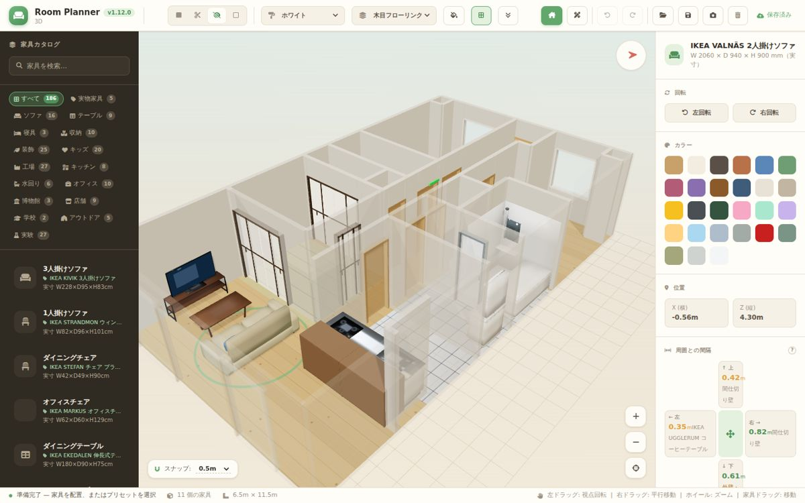
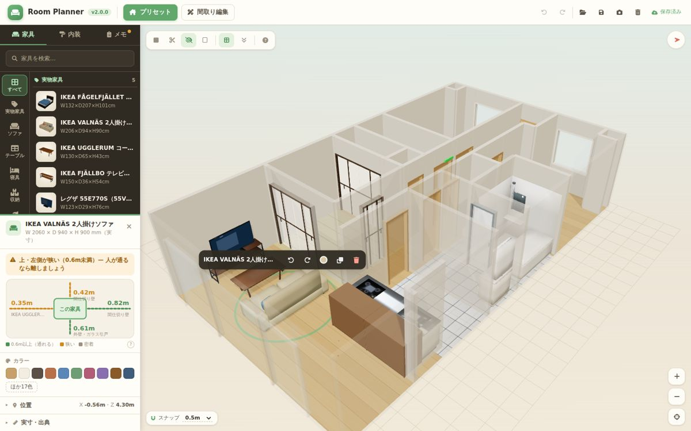
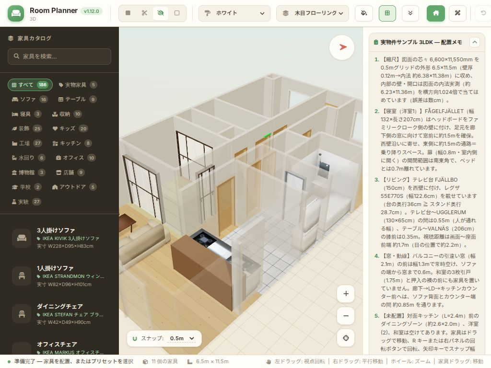
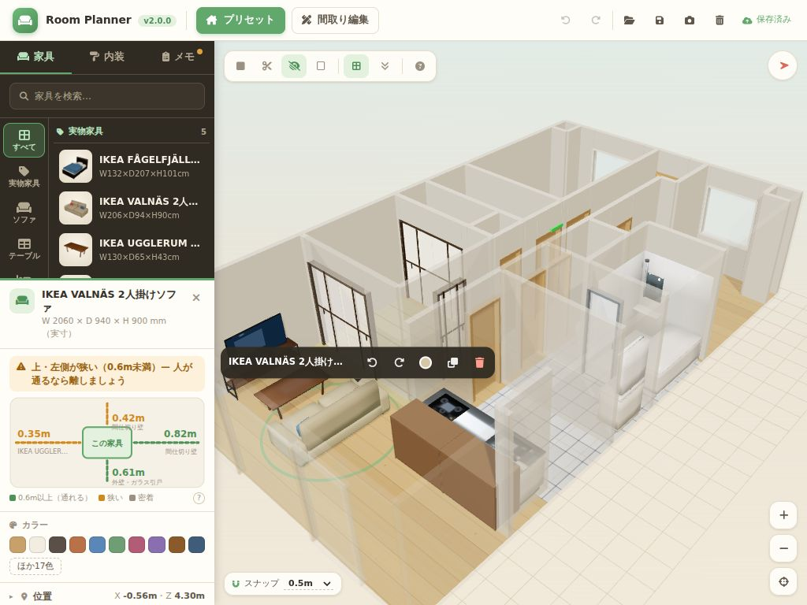
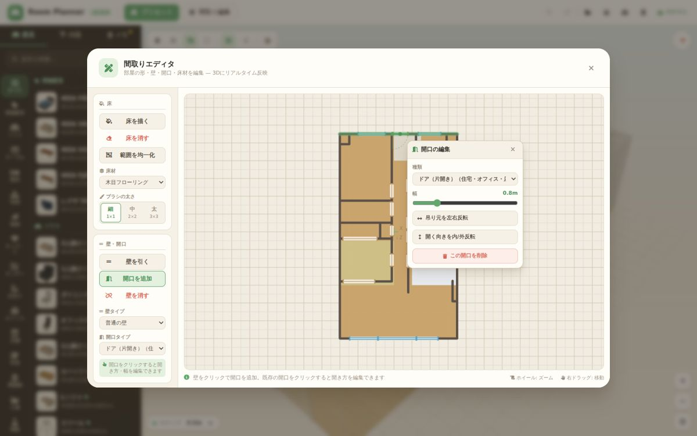
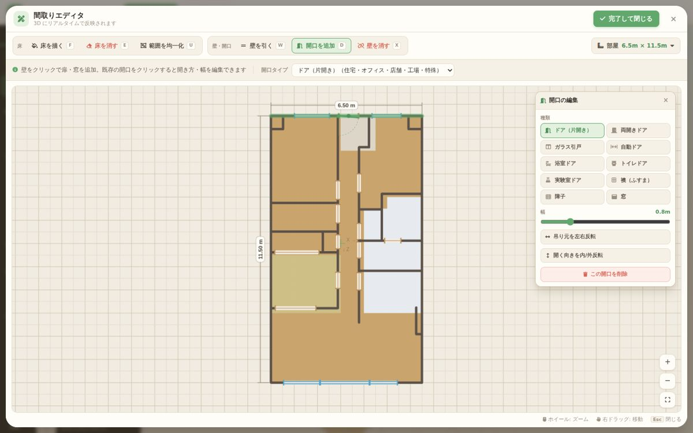
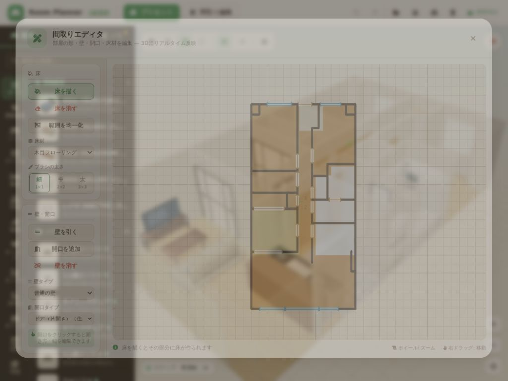
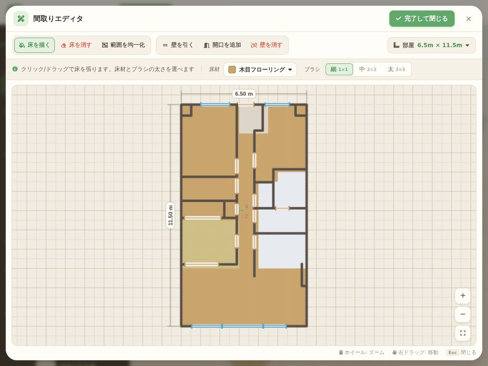

# UI/UX 全面見直し — 7案スコア評価の記録（v2.0.0）

`CLAUDE.md` の「画面表示・UI 修正の意思決定ルール（7案スコア評価方式）」に従って、
メイン画面を3つの項目に分け、それぞれ案を出して現物キャプチャ（1440×900 / 1024×768、初期表示・家具選択中）で採点した。
各案は CSS／DOM の差分をページに注入した試作で撮影している。

採点は各20点 × 5観点 = 100点:
**U** 使いやすさ・直感性 / **C** わかりやすさ・情報設計 / **H** 階層構造・領域効率 / **V** 視覚表現 / **G** 汎用性・堅牢性

| | 変更前 | 変更後 |
|---|---|---|
| 1440×900 家具選択中 |  |  |
| 1024×768 |  |  |

## 変更前の主な問題
- ツールバーにアイコンだけのボタンが約20個。表示切替・内装・ファイル操作が混在し、1024幅では右端（保存・やり直し等）が画面外に切れる。
- 左カタログはカテゴリのチップ17個が縦に約300pxを占め、一覧は5件しか見えない。家具はアイコンだけで見分けにくい。
- 右パネル（268px）が常に表示され、非選択時は配置メモの長文、選択時は29色の大きな色見本で「周囲との間隔」「複製・削除」が画面外へ押し出される。間隔の表示も文字が詰まって崩れる。
- ステータスバーは操作説明の長文で、情報量の割に1行を常に使う。

---

## 項目A: 画面骨格とツールバー

### 1回目
| 案 | 内容 | U | C | H | V | G | 計 |
|---|---|---|---|---|---|---|---|
| A1 | 3カラム整理（ラベル付きツールバー、表示ツールをキャンバス上へ、右パネルは必要時のみ） | 14 | 15 | 11 | 13 | 10 | 63 |
| A2 | 左アイコンレール＋展開パネル、詳細はキャンバス上のフローティングカード | 16 | 15 | 16 | 15 | 15 | 77 |
| A3 | カタログを下部ドックに横並び | 13 | 14 | 13 | 15 | 10 | 65 |
| A4 | 全面キャンバス＋すべてフローティングパネル | 14 | 13 | 15 | 16 | 9 | 67 |
| A5 | 左パネル1枚をタブ化（家具/内装/選択中/メモ）、選択で自動切替 | 15 | 16 | 17 | 14 | 16 | 78 |
| A6 | ＊方向違い: 作業ステップ（間取り→家具→仕上げ→保存）のウィザード | 13 | 15 | 12 | 15 | 10 | 65 |
| A7 | ＊方向違い: オンキャンバス操作（選択物の上にミニツールバー、カタログは「＋家具を追加」） | 16 | 14 | 18 | 16 | 14 | 78 |

最高78点（90点未満）かつ上位が僅差 → 2回目へ。
抽出したエッセンス: タブで1枚のパネルに集約（A5）、選択物の近くの操作バー（A7）、細いツールバー＋ステータスバー廃止で高さを確保（A2）、表示ツールはキャンバス左上（A1）。

### 2回目（上位3案 + 再構成4案）
| 案 | 内容 | 計 |
|---|---|---|
| A5 / A7 / A2 | 1回目の上位 | 78 / 78 / 77 |
| A8 | アイコンレール＋1枚パネル（家具/内装/詳細/メモ）＋ミニツールバー | 82 |
| A9 | タブ付き左パネル＋フローティング詳細カード＋ミニツールバー | 82 |
| A10 | 開閉式カタログドロワー＋内装を表示バーへ＋フローティング詳細 | 72 |
| A11 | ツールバーにモードタブ（家具/内装/間取り/メモ）＋下部の詳細ドロワー | 70 |

最高82点（90点未満）→ 3回目へ。
わかったこと: 選択中もカタログが見えている方が続けて配置しやすい（A9）、ただしフローティング詳細は3Dビューを覆う。

### 3回目（上位3案 + 再構成4案、全案に同じ詳細パネルの圧縮を適用して公平に比較）
| 案 | 内容 | U | C | H | V | G | 計 |
|---|---|---|---|---|---|---|---|
| A8r | A8 | 17 | 16 | 18 | 16 | 17 | 84 |
| A9r | A9 | 17 | 17 | 17 | 17 | 17 | 85 |
| A5r | A5 | 16 | 16 | 18 | 15 | 17 | 82 |
| **A12** | **タブ付き左パネル（家具/内装/メモ）＋選択時はパネル下部に詳細を分割表示＋ミニツールバー** | 18 | 17 | 19 | 17 | 18 | **89** |
| A13 | A9＋詳細カードを内容の高さに＋パネル折りたたみ | 18 | 17 | 17 | 18 | 17 | 87 |
| A14 | 選択時だけ右に詳細パネルをドッキング（3Dビューが縮む） | 16 | 17 | 17 | 16 | 16 | 82 |
| A15 | タブ自動切替（選択→詳細、解除→元のタブ）＋「カタログに戻る」 | 17 | 17 | 18 | 17 | 17 | 86 |

→ 3回目の最高点 **A12** を採用。3Dビューを覆わず・縮めず、カタログを見ながら選択中の家具を編集できる。

---

## 項目B: 家具カタログ（A12 の「家具」タブ内）

### 1回目
| 案 | 内容 | 計 |
|---|---|---|
| B1 | カテゴリをドロップダウン化＋1行の密な一覧 | 78 |
| B2 | カテゴリのチップ1行（横スクロール）＋2列カード | 68 |
| B3 | カテゴリを縦のアイコン列にして一覧と左右に並べる | 82 |
| B4 | カテゴリ見出し付きの一覧（見出しは貼り付き）＋「絞り込み」で開くチップ | 81 |
| B5 | 3Dサムネイル付きの2列グリッド | 78 |
| B6 | ＊方向違い: 検索ファースト＋最近使った/よく使う | 75 |
| B7 | ＊方向違い: シーン（住まい/仕事・店/工場・研究/屋外）→カテゴリの2段階 | 75 |

最高82点 → 2回目へ。エッセンス: 縦のカテゴリ列（B3）、見出し区切り（B4）、密な行（B1）、実物の3Dサムネイル（B5）、最近使った（B6）。

### 2回目
| 案 | 内容 | U | C | H | V | G | 計 |
|---|---|---|---|---|---|---|---|
| B3 / B4 | 1回目の上位 | | | | | | 82 / 81 |
| B5 | 2列サムネイル（列幅の不具合を直して再撮影） | 17 | 17 | 16 | 19 | 15 | 84 |
| B8 | 縦カテゴリ列＋2列サムネイル＋見出し | 18 | 18 | 17 | 19 | 16 | 88 |
| **B9** | **縦カテゴリ列＋小さな3Dサムネイル付きの密な行＋見出し** | 18 | 18 | 19 | 18 | 17 | **90** |
| B10 | チップ1行＋最近使った＋2列サムネイル＋見出し | 17 | 16 | 15 | 19 | 15 | 82 |
| B11 | 縦カテゴリ列＋1行の密な一覧＋最近使った | 17 | 16 | 19 | 14 | 17 | 83 |

→ **B9**（90点）を採用。1440×900 で約14件が見え、サムネイルで形がひと目でわかる。

---

## 項目C: 選択中の家具の詳細（A12 のパネル下部）

### 1回目
| 案 | 内容 | 計 |
|---|---|---|
| C1 | アコーディオン（閉じても要約値を表示） | 79 |
| C2 | 詳細の中をタブ（基本/周囲の間隔/実寸・出典） | 78 |
| C3 | 超コンパクト（1行ずつ） | 74 |
| C4 | 周囲との間隔を上から見た図で表示 | 85 |
| C5 | 位置・回転を数値入力できる | 77 |
| C6 | ＊方向違い: 間隔を3Dビューの上に寸法ラベルで表示 | 83 |
| C7 | ＊方向違い: 「左側が狭い」などの文章で判定を伝える | 82 |

最高85点 → 2回目へ。共通の改善: 回転・複製・削除はミニツールバーにあるので、見出しは家具名に全幅を使う。

### 2回目
| 案 | 内容 | U | C | H | V | G | 計 |
|---|---|---|---|---|---|---|---|
| C4 / C6 / C7 | 1回目の上位 | | | | | | 85 / 83 / 82 |
| **C8** | **ひとことの判定（C7）＋上から見た図（C4）＋カラー10色と「ほか○色」＋位置・実寸は折りたたみ（C1）** | 18 | 19 | 18 | 18 | 17 | **90** |
| C9 | 3Dビューに引き出し線つき寸法（C6）＋判定 | 18 | 18 | 19 | 19 | 14 | 88 |
| C10 | 上から見た図に矢印ボタンで微調整 | 18 | 18 | 18 | 18 | 16 | 88 |
| C11 | アコーディオンで図とカラーを開いた状態＋複製/削除ボタン | 17 | 18 | 17 | 17 | 17 | 86 |

→ **C8**（90点）を採用。

---

## 採用した設計（v2.0.0 で実装）
- **ツールバー**: 「プリセット」「間取り編集」（文字付き）＋元に戻す/やり直し＋ファイル操作＋自動保存の状態だけ。1024幅でも切れない。
- **左パネル**: タブ「家具」「内装」「メモ」。メモがあるとタブに点。
- **家具タブ**: 検索＋縦のカテゴリ列＋3Dサムネイル付きの一覧（見えている行だけ、手の空いたときに描いてキャッシュ。人物はアイコン）。「すべて」ではカテゴリ見出しで区切る。
- **内装タブ**: 壁紙・床材・床ペイント（説明付きのトグル）・部屋の外形と家具の点数。
- **選択中の家具**: パネル下部に分割表示（最大58%）。判定文→上から見た間隔図→カラー→位置→実寸・出典。×で選択解除。
- **ミニツールバー**: 選択した家具の真上に追従（回転・色・複製・削除）。
- **3Dビュー**: 左上に表示ツール（壁の見せ方・グリッド・真上・操作方法？）。ステータスバーは廃止し、配置中・床ペイント中は画面下のヒントに「いま何をしているか」と使えるキーだけを出す。

今回の対象外: プリセット選択のモーダル（構成は従来どおり）。2D間取りエディタは v2.1.0 で見直した（下記）。

---

# 2D間取りエディタの見直し（v2.1.0）

| | 変更前 (v2.0.0) | 変更後 (v2.1.0) |
|---|---|---|
| 1440×900 開口を編集中 |  |  |
| 1024×768 |  |  |

## 変更前の主な問題
- 描画バッファが 900×600 固定で、表示サイズに引き伸ばされていた（文字・線がにじみ、縦横比もずれる）。図面も小さく表示される。
  → デザイン案ではなく不具合なので、評価の前に直して全案の共通の土台にした（表示サイズ × devicePixelRatio で描画、開いたら全体が収まる倍率に合わせる）。
- 左のツール欄が縦に長く、700px の高さでは「部屋サイズ」「操作」「凡例」「完了」が下に隠れてスクロールが必要。
- 壁タイプ・開口タイプ・床材の選択がツールと関係なく常に並び、いま何を選べばよいか分かりにくい。床材・壁タイプが文字だけのセレクト。
- 部屋サイズのスライダーを動かすと間取りが長方形に作り直されるのに、注意書きがなく気軽に触れる位置にある。
- 開口の編集ポップオーバーが図面の上（開口のすぐ横）に出て、間取りを隠す。図面に寸法がない。

## 項目D: エディタの骨格・ツール配置

### 1回目
| 案 | 内容 | 計 |
|---|---|---|
| D1 | ほぼ全画面＋サイドバー整理（部屋サイズ・操作・凡例を折りたたみ） | 72 |
| D2 | 上部ツールバー（床／壁・開口のグループ）＋選んだツールの設定だけを出す設定バー | 82 |
| D3 | 左のアイコン列＋右に設定パネル | 79 |
| D4 | 図面の上にツールパレットと設定を浮かべる | 81 |
| D5 | サイドバーをタブ化（床／壁・開口／部屋） | 78 |
| D6 | ＊方向違い: エディタを左に寄せ、右に 3D を並べて表示 | 73 |
| D7 | ＊方向違い: 「部屋の大きさを決める」「床を張る」など目的別のカード | 74 |

最高82点 → 2回目へ。エッセンス: ラベル付きツールを1行に（D2）、設定はツールに応じて（D2/D3）、部屋サイズ・操作はボタンの奥へ（D4）、目的を言葉で説明（D7）。

### 2回目
| 案 | 内容 | 計 |
|---|---|---|
| D2 / D4 / D3 | 1回目の上位 | 82 / 81 / 79 |
| D8 | 1行ツールバー＋設定バー＋「部屋」ポップオーバー＋完了を見出しへ | 87 |
| D9 | ラベル付きの浮かぶパレット＋設定カード（説明文つき） | 84 |
| D10 | アイコン列＋右に説明と設定（部屋は見出しへ） | 82 |
| D11 | D8＋設定バーにツールの説明文＋ツールのショートカットキー表示 | 88 |

最高88点 → 3回目へ。

### 3回目
2回目の撮影で「選んだツールの設定だけを出す」切り替えが試作のバグで実際には効いていなかったことが分かったため、
直してから3回目の7案をすべて撮り直して採点した（2回目までの点はこの機能が動く前提でつけていた）。

| 案 | 内容 | U | C | H | V | G | 計 |
|---|---|---|---|---|---|---|---|
| D11 | 2回目の1位 | 19 | 18 | 18 | 15 | 17 | 87 |
| D8 | 2回目の2位 | 18 | 17 | 18 | 15 | 17 | 85 |
| D9 | 2回目の3位 | 17 | 17 | 18 | 17 | 15 | 84 |
| **D12** | **D11＋床材を色見本の一覧で選ぶ＋壁タイプを図面と同じ線の見本で選ぶ（凡例を兼ねる）＋ズーム/全体表示ボタン** | 19 | 19 | 18 | 18 | 17 | **91** |
| D13 | D11＋床材の色見本を設定バーに横一列で表示 | 18 | 17 | 17 | 18 | 14 | 84 |
| D14 | D9（浮かぶパレット）＋色見本・線の見本＋ズーム | 17 | 18 | 18 | 18 | 15 | 86 |
| D15 | ツールと設定を1本のバーにまとめる | 17 | 16 | 17 | 17 | 14 | 81 |

→ **D12** を採用。

## 項目E: 図面の表現と開口の編集（D12 の上で比較）

### 1回目
| 案 | 内容 | 計 |
|---|---|---|
| E1 | 全体寸法の寸法線＋各壁の長さラベル | 81 |
| E2 | 部屋ごとの広さ（帖・m²・床材）ラベル ※撮影時は部屋の判定が失敗し1部屋扱い | 70 |
| E3 | 扉の開き（円弧）・引戸を常に表示 | 79 |
| E4 | 壁・床にマウスを乗せると種類・長さを表示 | 82 |
| E5 | 開口の編集をキャンバス右上に固定し、種類をアイコン一覧で選ぶ | 88 |
| E6 | ＊方向違い: 床の模様・厚みのある壁で建築図面らしく描く | 80 |
| E7 | ＊方向違い: エディタ内に 3D の小窓プレビュー | 80 |

最高88点 → 2回目へ（部屋の判定は 0.25m 格子に直した。壁がセルの中央にも置かれるため）。

### 2回目
| 案 | 内容 | U | C | H | V | G | 計 |
|---|---|---|---|---|---|---|---|
| E5 / E4 / E1 | 1回目の上位 | | | | | | 88 / 82 / 81 |
| **E8** | **E5＋全体寸法（幅・奥行）だけ＋マウスを乗せた壁の長さ・種類を表示** | 19 | 18 | 19 | 17 | 17 | **90** |
| E9 | E5＋全体寸法＋部屋ごとの帖・m²ラベル（小さい部屋でラベルが重なる） | 18 | 19 | 16 | 18 | 16 | 87 |
| E10 | E5＋床の模様＋扉の開き＋全体寸法 | 17 | 17 | 17 | 19 | 16 | 86 |
| E11 | E5＋3D 小窓＋全体寸法＋ホバー表示 | 19 | 18 | 17 | 18 | 16 | 88 |

→ **E8**（90点）を採用。

## 採用した設計（v2.1.0 で実装）
- ほぼ全画面のモーダル。見出しの右に「完了して閉じる」。
- ツールバー1行: 「床」（床を描く F／床を消す E／範囲を均一化 U）「壁・開口」（壁を引く W／開口を追加 D／壁を消す X）、右端に「部屋 6.5m × 11.5m」。
- 設定バー: 選んだツールの説明文と、そのツールに関係する設定だけ（床を描く＝床材・ブラシ、床を消す＝ブラシ、壁を引く＝壁タイプ、開口を追加＝開口タイプ）。
  床材は色見本つきの一覧、壁タイプは図面と同じ色・線種の見本で選ぶ（凡例を兼ねる）。
- 「部屋」ポップオーバー: 幅・奥行のスライダー（長方形に作り直される旨の注意書き）、長方形に戻す、全消去（確認あり）。
- 図面: 表示サイズに合わせた解像度で描画、全体寸法（幅・奥行）の寸法線、ズーム／全体表示ボタン、壁・床にマウスを乗せると種類・長さ・開口の数を表示。
- 開口の編集: キャンバス右上に固定（間取りを隠さない）。種類はアイコンつきの一覧（使えるシーンはツールチップ）、幅、吊り元・開く向き、削除。
- キー操作: F/E/U/W/D/X でツール切替、Esc は開いているポップオーバー → エディタの順に閉じる。
